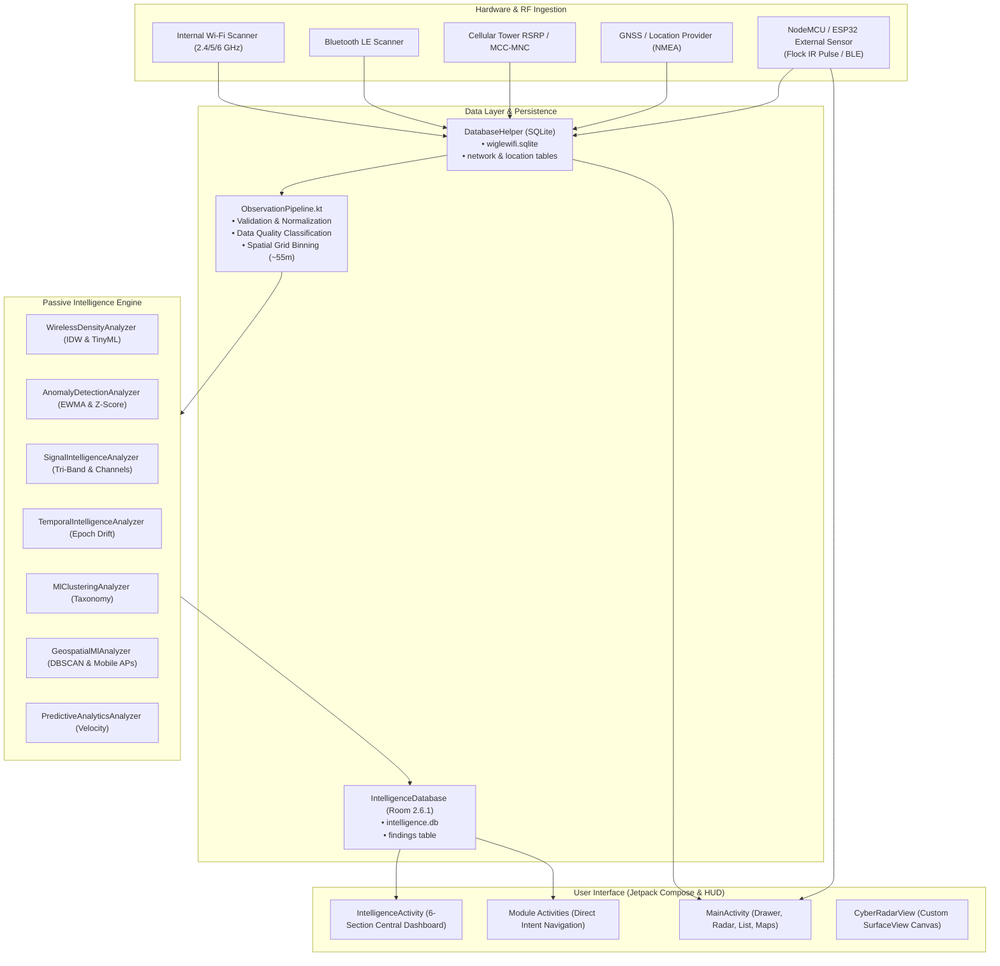
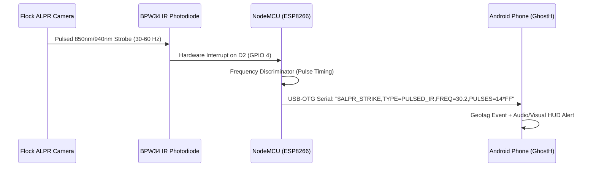

# GHOSTH // WARDRIVER HX OS ⚡

[-brightgreen.svg)](https://developer.android.com)
[](https://kotlinlang.org)
[](https://developer.android.com/jetpack/compose)
[](https://developer.android.com/training/data-storage/room)
[](#passive-operational-principles)

**GhostH (droid.wardriver.hx.os)** is an advanced, tactical Android wardriving, RF signal intelligence, and wireless spatial analytics platform. Built on top of the battle-tested WiGLE Android core, GhostH elevates RF reconnaissance with a sleek **Cyberpunk HUD interface**, a full-featured **Passive Machine Learning & Analytics Engine**, **OpenStreetMap (FOSS) offline vector mapping**, and an **External Hardware Subsystem** for detecting Flock Safety ALPR infrared strobes and ESP32/NodeMCU sensor streams.

---

## 📑 Table of Contents
- [Key Features](#-key-features)
- [Architecture & Tech Stack](#-architecture--tech-stack)
- [Wireless Intelligence & Analytics](#-wireless-intelligence--analytics)
  - [1. Wireless Density Prediction](#1-wireless-density-prediction)
  - [2. Anomaly Detection Engine](#2-anomaly-detection-engine)
  - [3. Signal Intelligence](#3-signal-intelligence)
  - [4. Main Intelligence Dashboard](#4-main-intelligence-dashboard)
  - [5. Shared Processing Pipeline](#5-shared-processing-pipeline)
- [Flock ALPR & NodeMCU Hardware Subsystem](#-flock-alpr--nodemcu-hardware-subsystem)
- [Tactical Cyberpunk HUD UI](#-tactical-cyberpunk-hud-ui)
- [Project Structure](#-project-structure)
- [Building & Installation](#-building--installation)
- [Passive Operational Principles & Disclaimer](#-passive-operational-principles--disclaimer)
- [Attributions & License](#-attributions--license)

---

## ⚡ Key Features

* **100% Passive & Metadata-Only**: Zero packet payload capture, zero network association, and zero frame injection. Fully compliant with passive RF listening standards.
* **Cyberpunk Tactical HUD**:
  * High-contrast dark palette (`#05070E` background, `#00FFF2` Cyber Cyan, `#FF1F8F` Threat Pink).
  * Real-time **Cyber Radar View** with azimuth orientation, distance range rings, and RF sweeping indicators.
  * Device-type classification icons (Vehicles, Cameras, Smart TVs, Phones, Headsets, IoT sensors).
* **FOSS OpenStreetMap Integration**:
  * Seamless offline vector and raster mapping via MapLibre / OpenStreetMap (no proprietary Google Maps API required).
  * Instant map provider switching between Google Maps and OpenStreetMap.
* **On-Device Machine Learning & Intelligence Suite**:
  * 7 dedicated passive analyzers behind a unified architecture.
  * Spatial density grid binning with Inverse Distance Weighting (IDW) and on-device TinyML polynomial forecasting.
  * Exponentially Weighted Moving Average (EWMA) and Z-score anomaly tracking.
  * Tri-band spectrum utilization analysis ($2.4\,\text{GHz}$, $5\,\text{GHz}$, and $6\,\text{GHz}$ Wi-Fi 6E/7).
* **External Hardware & ALPR Detection**:
  * Direct USB-OTG Serial (`115200` baud) and Bluetooth SPP/BLE telemetry parser.
  * Real-time detection of **Flock Safety ALPR pulsed infrared (850nm / 940nm) illuminators** via NodeMCU / ESP8266 optical sensor modules.
* **OSINT Intelligence**:
  * Automated OUI MAC hardware vendor lookup.
  * Random / Private MAC rotation detection.
  * Geospatial cluster centroid trilateration.
* **Reporting & Export**:
  * Multi-format export: **PDF Threat & Density Reports**, **CSV Analytics Datasets**, **KML**, and **GPX Route Tracks**.

---

## 🛠 Architecture & Tech Stack



---

## 🧠 Wireless Intelligence & Analytics

The **Intelligence** sub-system is a native Jetpack Compose architecture operating completely off the main scan thread (`Dispatchers.IO` coroutines). All metrics are derived from actual SQLite records (`wiglewifi.sqlite`) and live memory caches.

### 1. Wireless Density Prediction
* **Spatial Grid Binning**: Divides geographic areas into $\sim 55\,\text{m}$ sectors ($\sim 0.003\,\text{km}^2$).
* **Concentration Calculations**: Computes $\text{APs}/\text{km}^2$ and classifies sectors into `HIGH` ($\ge 12\,\text{APs}$), `MEDIUM` ($5\text{--}11\,\text{APs}$), and `LOW` ($< 5\,\text{APs}$) density zones.
* **Strict Prediction Separation**: Fringe boundary sectors are estimated using Inverse Distance Weighting (IDW) interpolation and labeled `[MODEL-ESTIMATED COVERAGE]`. **Predictions are never presented as confirmed observations.**
* **5 Map Visualization Modes**:
  1. `DENSITY_HEATMAP`: Color-coded heat spots (Cyan $\to$ Yellow $\to$ Threat Pink).
  2. `OBSERVATION_CLUSTERS`: Circular cluster pins displaying AP counts.
  3. `NETWORK_DISTRIBUTION`: Individual dot points color-coded by security protocol (Open, WEP, WPA2, WPA3, BLE).
  4. `SIGNAL_STRENGTH_HEATMAP`: Smooth RSSI signal propagation halos.
  5. `COVERAGE_LAYER`: **Confirmed Observed Coverage** (solid cyan blocks) vs **Model-Estimated Coverage** (magenta blocks with dashed borders).

### 2. Anomaly Detection Engine
* **Observation Anomalies**:
  * Duplicate records (exact BSSID, timestamp, and coordinates flagged without deleting evidence).
  * Inconsistent metadata (channel mismatches against RF frequency, contradictory WPA capabilities).
  * Invalid coordinates (`0.0, 0.0` or out-of-range GPS points).
  * Inconsistent timestamps (future timestamps or pre-2005 epochs).
* **Signal Anomalies**:
  * Exponentially Weighted Moving Average (EWMA) tracking with variance baselines.
  * Z-score divergence ($> 2.5\sigma$) and sudden RSSI shifts ($> 20\,\text{dBm}$).
  * Abrupt cross-band jumping ($2.4\,\text{GHz} \to 5\,\text{GHz}/6\,\text{GHz}$ on single MAC address).
* **Operational Rule**: *An unusual observation is not proof of an attack.* Every flagged anomaly includes an Anomaly ID (`ANOM-...`), timestamp, observation reference, category, objective explanation, confidence score, and recommended data-quality action.

### 3. Signal Intelligence
* **RSSI Distribution**: Real-time histogram from $-100\,\text{dBm}$ to $-30\,\text{dBm}$ with standard quality classifications (Excellent, Good, Fair, Poor).
* **Tri-Band Spectrum Analytics**: Real-time distribution across $2.4\,\text{GHz}$, $5\,\text{GHz}$, and $6\,\text{GHz}$ (Wi-Fi 6E/7).
* **Channel Concentration**: Channel count distribution across channels 1–14, 36–165, and 1–93.
* **RF Disclaimer**: Displays explicit notice: *"Observed AP counts represent passive beacon observations; true RF spectral utilization requires active spectrum analysis."*

### 4. Main Intelligence Dashboard
Accessible from the main menu drawer or directly via Intent (`net.wigle.wigleandroid.intelligence.ui.IntelligenceActivity`):
1. **Wireless Overview**: Top KPI cards (Total Observations, Unique APs, Anomalies, Sectors, Observed Coverage, Average Density), interactive map viewport, and direct module launchers.
2. **Density Intelligence**: Multi-mode map, analysis radius selector ($50\,\text{m}, 100\,\text{m}, 250\,\text{m}, 500\,\text{m}, 1000\,\text{m}$), and confirmed vs estimated coverage statistics.
3. **Anomaly Detection**: Category filters, severity breakdown, and comprehensive audit card list.
4. **Signal Intelligence**: RSSI histogram chart, tri-band spectrum breakdown, and channel concentration chart.
5. **Historical Analytics**: Timeline comparison ($1\text{h}, 24\text{h}, 7\text{d}, \text{All}$), observation velocity, and temporal findings.
6. **Data Quality**: Breakdown of records by quality status (`Normal`, `Inconsistent`, `Duplicate`, `Incomplete`, `Requires Review`).

### 5. Shared Processing Pipeline
Implemented in `ObservationPipeline.kt`, running a 9-step workflow:
1. Database Retrieval $\to$ 2. Coordinate & Signal Validation $\to$ 3. Normalization $\to$ 4. Handling Missing Fields $\to$ 5. Duplication Flagging $\to$ 6. Data Quality Assignment $\to$ 7. Feature Generation $\to$ 8. Multi-Analyzer Execution $\to$ 9. Room Persistence & Reactive StateFlow UI emission.

---

## 📷 Flock ALPR & NodeMCU Hardware Subsystem

> [!TIP]
> For the complete step-by-step hardware wiring, flashing, and troubleshooting guide, see the **[NodeMCU Setup & Troubleshooting Wiki](wiki/NodeMCU-Companion-Guide.md)**.

Flock Safety ALPR (Automatic License Plate Recognition) cameras use **high-power 850nm / 940nm pulsed infrared LED strobes** flashing at camera shutter sync frequencies ($30\text{--}60\,\text{Hz}$) to capture license plates in all lighting conditions.



### Wiring Diagram (NodeMCU to IR Sensor)

| Sensor Pin (LM393 + BPW34) | NodeMCU (ESP8266) Pin | ESP32 Pin | Purpose |
| :--- | :--- | :--- | :--- |
| **VCC** | `3V3` (or `VIN` if 5V module) | `3V3` / `5V` | Power supply |
| **GND** | `GND` | `GND` | Ground |
| **D0 (Digital Output)** | `D2` (GPIO 4) | `GPIO 4` | Hardware interrupt for pulse timing |
| **A0 (Analog Output)** | `A0` (ADC0) | `GPIO 34` | Raw optical irradiance level |
| **Buzzer / LED (+)** | `D1` (GPIO 5) | `GPIO 2` | Local audible/visual alarm |

### Firmware Logic
The NodeMCU firmware uses an `IRAM_ATTR` interrupt on `D2` to measure pulse intervals. When it detects at least 10 valid pulses within a 400 ms window matching the $25\text{--}65\,\text{Hz}$ ALPR strobe window, it outputs:
```text
$ALPR_STRIKE,TYPE=PULSED_IR,FREQ=30.2,PULSES=14,IR_RAW=810*FF
```
The Android app reads this stream over USB-OTG serial, associates it with the current GPS coordinates, stores it in `intelligence.db`, and alerts the user on the radar map.

---

## 🎨 Tactical Cyberpunk HUD UI

* **Palette**:
  * **Background**: Pure Cyber Black (`#05070E`) / Panel Surface (`#0D111A`)
  * **Primary Accent**: Cyber Cyan (`#00FFF2`)
  * **Threat / Alert Accent**: Cyber Pink (`#FF1F8F`)
  * **Signal / Safe Accent**: Cyber Green (`#00FF88`)
  * **Warning Accent**: Cyber Yellow (`#FFE500`)
* **Radar Sweep**: `CyberRadarView` implements hardware-accelerated canvas rendering with azimuth compass heading, range rings ($25\,\text{m}, 50\,\text{m}, 100\,\text{m}$), and signal intensity dots.
* **Minimalist Design**: Removed unnecessary borders and gradient bars; uses clean flat cards and high-legibility typography (`JetBrains Mono` / system monospace).

---

## 📁 Project Structure

```text
wiglewifiwardriving/src/main/
├── AndroidManifest.xml
├── java/net/wigle/wigleandroid/
│   ├── MainActivity.java                   # Primary navigation drawer & wardrive lifecycle
│   ├── FossNetworkActivity.java            # FOSS OpenStreetMap vector map viewer
│   ├── ExternalHardwareFragment.java       # USB-OTG serial & BLE hardware manager
│   ├── db/
│   │   └── DatabaseHelper.java             # Core SQLite database worker (wiglewifi.sqlite)
│   ├── ui/
│   │   ├── CyberRadarView.java             # Cyberpunk animated radar canvas
│   │   └── SetNetworkListAdapter.java      # Hardware device-type icon adapter
│   ├── intelligence/
│   │   ├── analyzer/                       # 7 Modular Intelligence Analyzers
│   │   │   ├── Analyzer.kt                 # Common passive interface
│   │   │   ├── WirelessDensityAnalyzer.kt  # Spatial binning & IDW fringe interpolation
│   │   │   ├── TinyMlDensityPredictor.kt   # On-device polynomial prediction model
│   │   │   ├── AnomalyDetectionAnalyzer.kt # EWMA baseline & Z-score anomaly detector
│   │   │   ├── SignalIntelligenceAnalyzer.kt # Tri-band spectrum & channel congestion
│   │   │   ├── TemporalIntelligenceAnalyzer.kt # Network emergence & drift tracking
│   │   │   ├── MlClusteringAnalyzer.kt     # Environmental fingerprint classification
│   │   │   ├── GeospatialMlAnalyzer.kt     # DBSCAN clustering & mobile AP detection
│   │   │   └── PredictiveAnalyticsAnalyzer.kt # Trend velocity & trajectory modeling
│   │   ├── model/                          # Domain models (Observation, Finding, Severity)
│   │   ├── persistence/                    # Room Database (FindingDao, FindingEntity, intelligence.db)
│   │   ├── service/                        # ObservationPipeline.kt & IntelligenceEngine.kt
│   │   ├── export/                         # ReportExporter.kt (PDF & CSV export engine)
│   │   ├── replay/                         # ObservationReplayer.kt (Session simulation)
│   │   └── ui/                             # Jetpack Compose UI
│   │       ├── IntelligenceActivity.kt     # 6-Section Main Dashboard
│   │       ├── ModuleActivities.kt         # Dedicated sub-activities for each module
│   │       ├── IntelligenceViewModel.kt    # Reactive StateFlow view model
│   │       ├── IntelligenceTheme.kt        # Dark HUD styling & cyberpunk color palette
│   │       └── components/                 # SharedMapLayer, ModuleDetailScreen, FindingsList
│   └── osint/                              # Wireless & Geospatial OSINT Services & UI
```

---

## 🚀 Building & Installation

### Prerequisites
* **Android Studio** Ladybug / Hedgehog or newer.
* **JDK 17** or **JDK 21**.
* **Android SDK**: `compileSdk 35`, `minSdk 26`, `targetSdk 35`.
* **ADB** installed and USB debugging enabled on your target device.

### 1. Clone the Repository
```bash
git clone https://github.com/h9zdev/GHOSTH.git
cd GHOSTH
```

### 2. Run the Unit Test Suite
To verify all intelligence analyzers, OSINT services, and data pipelines:
```bash
./gradlew testDebugUnitTest --tests "net.wigle.wigleandroid.intelligence.*" --tests "net.wigle.wigleandroid.osint.*"
```

### 3. Assemble the Debug APK
```bash
./gradlew assembleDebug
```
The compiled APK will be located at:
```text
wiglewifiwardriving/build/outputs/apk/debug/wiglewifiwardriving-debug.apk
```

### 4. Install onto Connected Device
```bash
adb install -r wiglewifiwardriving/build/outputs/apk/debug/wiglewifiwardriving-debug.apk
```

### 5. Launch the Intelligence Dashboard Directly via ADB
```bash
adb shell am start -n droid.wardriver.hx.os/net.wigle.wigleandroid.intelligence.ui.IntelligenceActivity
```

---

## 🛡 Passive Operational Principles & Disclaimer

1. **Passive Operation**: GhostH operates in **100% passive monitoring mode**. It does not perform packet injection, does not connect to unauthenticated networks, and does not capture packet payload data.
2. **Data Privacy**: All analyses are conducted strictly on standard 802.11 beacon metadata, BLE advertisements, and cellular network status broadcast over open airwaves.
3. **Anomaly Context**: As enforced by the Anomaly Detection engine, *an unusual observation is not proof of an attack or malicious intent*. Common RF phenomena such as multipath interference, vehicular motion, captive portal deployments, and client-side private MAC rotation are objectively categorized.

---

## 📜 Attributions & License

This project is built upon the open-source **WiGLE Wi-Fi Wardriving** Android client, maintained by the [WiGLE.net team](https://wigle.net).

### Icon & Audio Attributions
* **Dashboard Icon**: [syalankush (Figma)](https://www.figma.com/@syalankush)
* **Eye, Filter, Map, Sort Icons**: [Dazzle UI](https://dazzleui.gumroad.com/l/dazzleiconsfree)
* **No WiFi Icon**: [d12da0b9_b193_4 (Figma)](https://www.figma.com/@d12da0b9_b193_4)
* **Share Icon**: [Noah Jacob](https://noahjacob.us/?ref=svgrepo.com)
* **User Star**: [Remix Design](https://github.com/Remix-Design/remixicon)
* **Wrench Icon**: [Font Awesome](https://github.com/FortAwesome/Font-Awesome)
* **Proximity Beep & Blip Audio**: [Balcoran (Freesound)](https://freesound.org/people/Balcoran)
